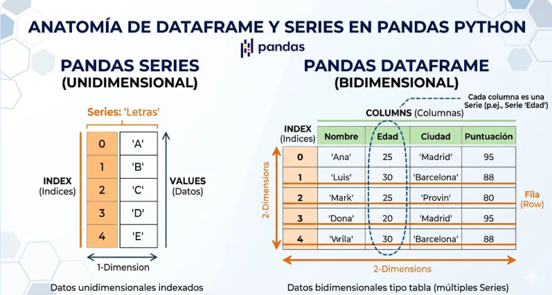
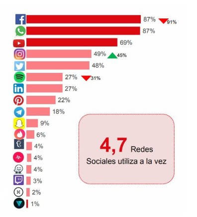
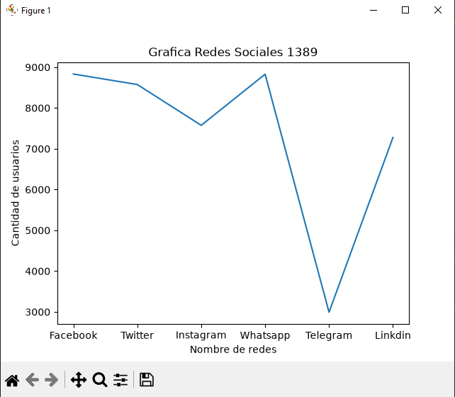
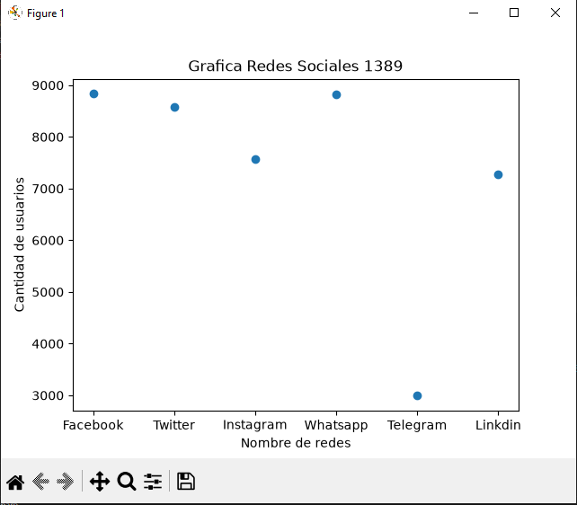
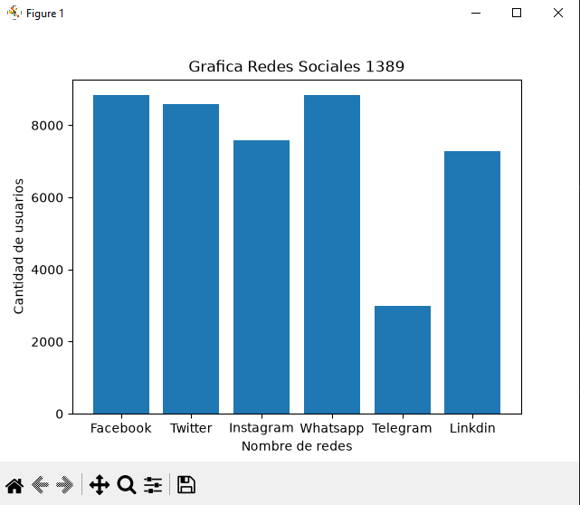
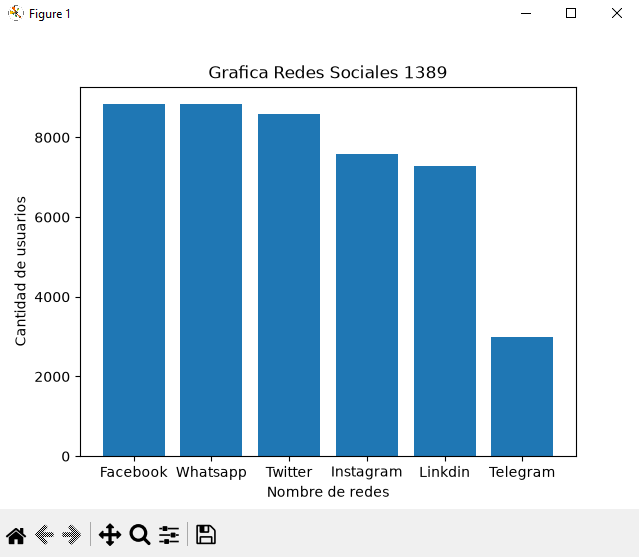
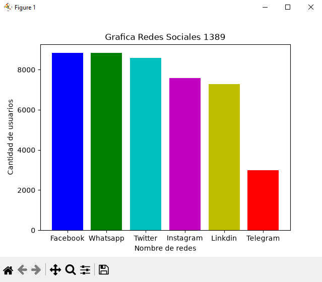
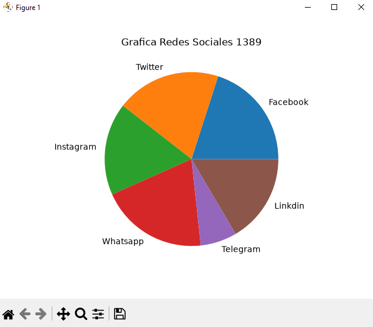

## dataframe o marco de datos pandas

## Redes soiales a nivel mundial

## Grafica lineal de Redes Sociales 

## Grafica puntos de Redes Sociales 

## Grafica barras de redes sociales

## Grafica barras del mas grande al mas chico

## Grafica barras color de redes sociales

## Grafica de pie de redessociales
